# PRACTICA1
## HUGO LUCENA MARISCAL
Dominios ficticios escogidos (es mi nombre y es facil de recordar):
* hugo.iaw.net
* lucena.iaw.local

Puerto interno en el que Apache escuchara dentro de su contenedor: 67
<br>
MPM: event. Se utiliza event porque delega las conexiones inactivas (Keep-Alive) a hilos dedicados del sistema. Esto optimiza el uso de memoria RAM y CPU al trabajar tras un proxy inverso

# EXPLICACIÓN DE LA PRÁCTICA

Antes de la Fase 1, tengo que hacer el docker. Para ello he creado una estructura de carpetas:

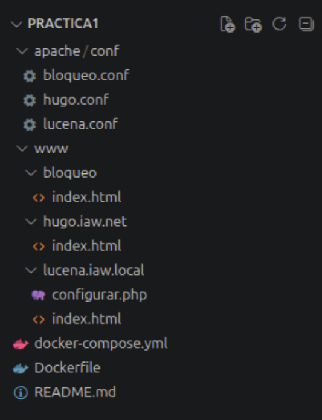

* **PRACTICA1:** Es la carpeta donde se aloja todo el docker.
* **docker-compose.yml:** Es un archivo con el que se le dice a Docker qué máquina crear y con qué reglas.
* **apache/conf/vhosts.conf:** Es un archivo de configuración personalizado. Es donde se escriben todas las reglas para que Apache gestione los dominios (ojo, Apache, no Docker). Como está en el host, puedo editarlo directamente desde ahí sin tener que entrar al docker (El cambio se hace automáticamente al reiniciar con el comando `docker-compose restart`).
* **/www:** Raíz pública del servidor web (tradicionalmente es `www/var/html` o `htdocs`).
* **hugo.iaw.net/ y lucena.iaw.local/:** Es para separar físicamente los archivos de cada web.

---

## Configurando Dockerfile

Este archivo se encarga de preparar la imagen base Apache basada en Ubuntu y hacer los cambios de configuración del puerto y los Virtual Hosts durante la construcción (así no hay que hacerlo en cada arranque).

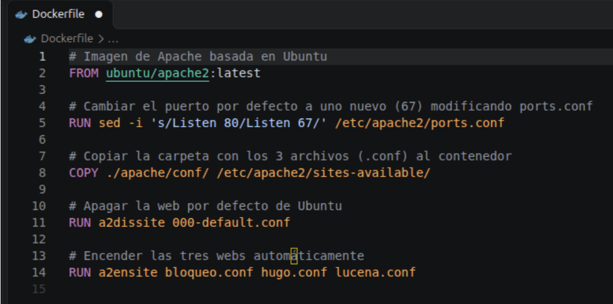

Ya hay otra práctica explicando el Dockerfile, pero aquí he añadido el parámetro `RUN` que sirve para decirle a la máquina que ejecute un comando mientras se está creando.

---

## Configurando docker-compose.yml

En lugar de ejecutar comandos larguísimos en la terminal, con `docker-compose.yml` defino toda la configuración de la máquina virtualizada (contenedor) en un archivo de texto estructurado.

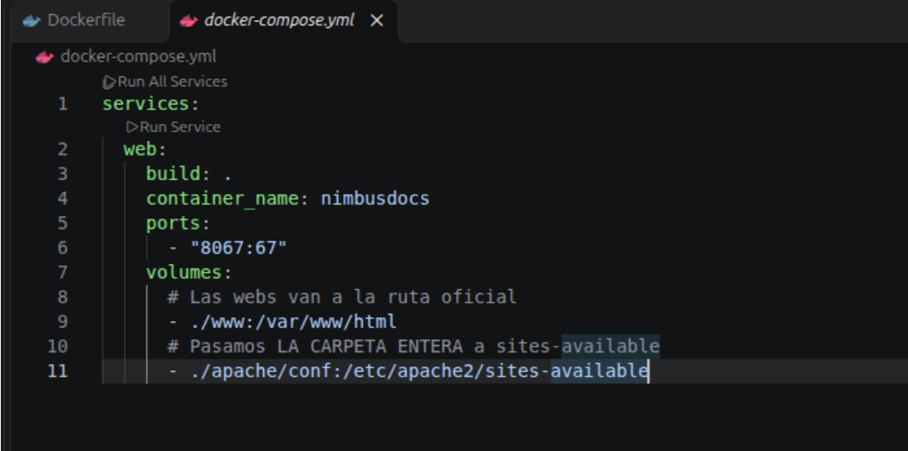

Los volúmenes permiten a los docker usar archivos físicos del host.

---

## Configurando vhosts.conf

Es un documento para almacenar distintas páginas web. Este se carga en el docker por la configuración de volúmenes que he establecido en `docker-compose.yml`.

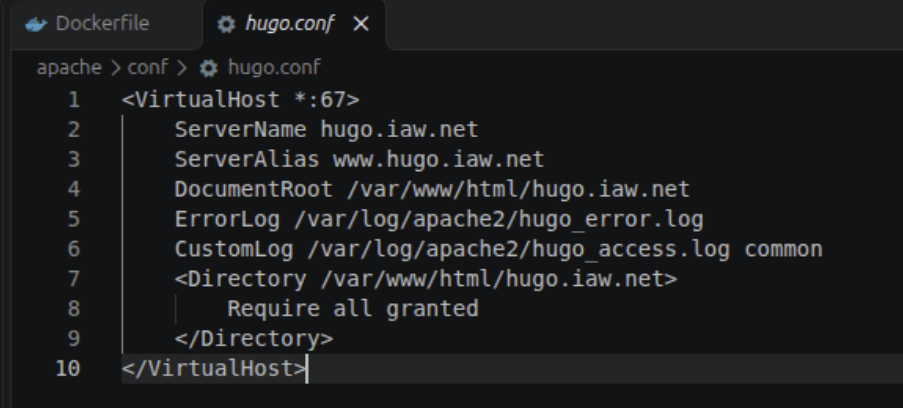

*(En el mismo directorio, otro archivo con el otro servidor)*

---

# FASE I

Con lo anterior hecho, puedo iniciar ya el docker. De los archivos que he creado hasta ahora, `docker-compose` y `Dockerfile` si se modifican, pueden provocar que haya que “formatear” el docker, cosa que no debería de tener riesgo puesto que la mayoría (o todas) las modificaciones que voy a hacer se van a hacer a través del host gracias a los volúmenes de `docker-compose`. En cambio, el archivo `vhosts.conf` sí puedo tocarlo sin problema porque está montado como volumen y de esta forma está “sincronizado” con el docker (de igual forma con los index de cada servidor). Lo que sí hace es que cuando edite este archivo, si tengo el docker encendido, tengo que reiniciarlo para aplicar el cambio.

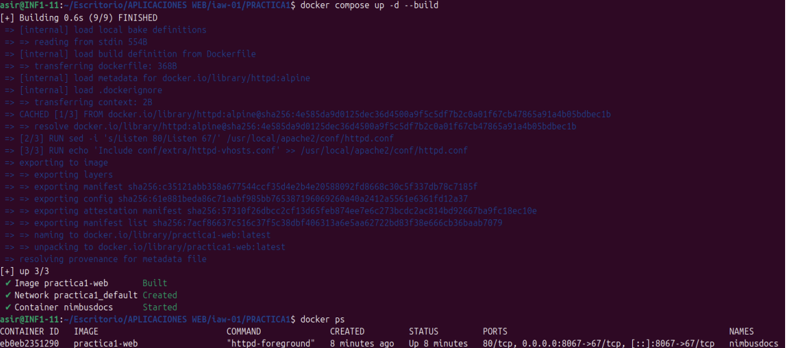

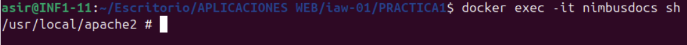

---

## Proteger archivo de marca interna

He creado un archivo de “configuración” para el dominio `lucena.iaw.local`:

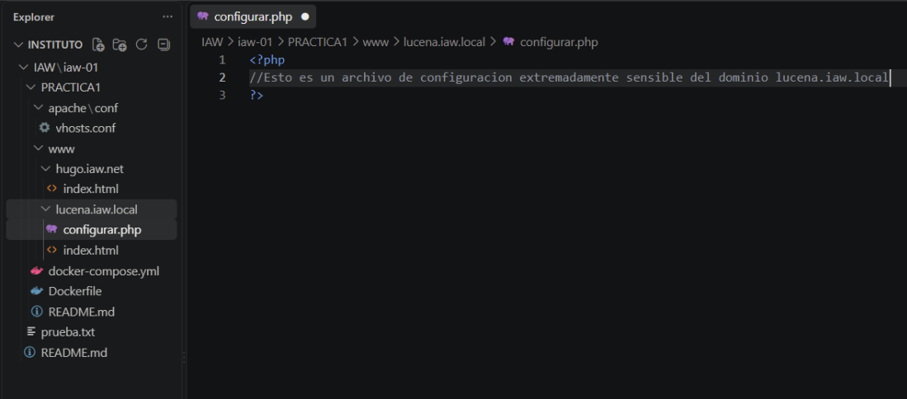

Para proteger este archivo de configuración, he añadido un par de líneas en el bloque de configuración del dominio en `vhosts.conf`:

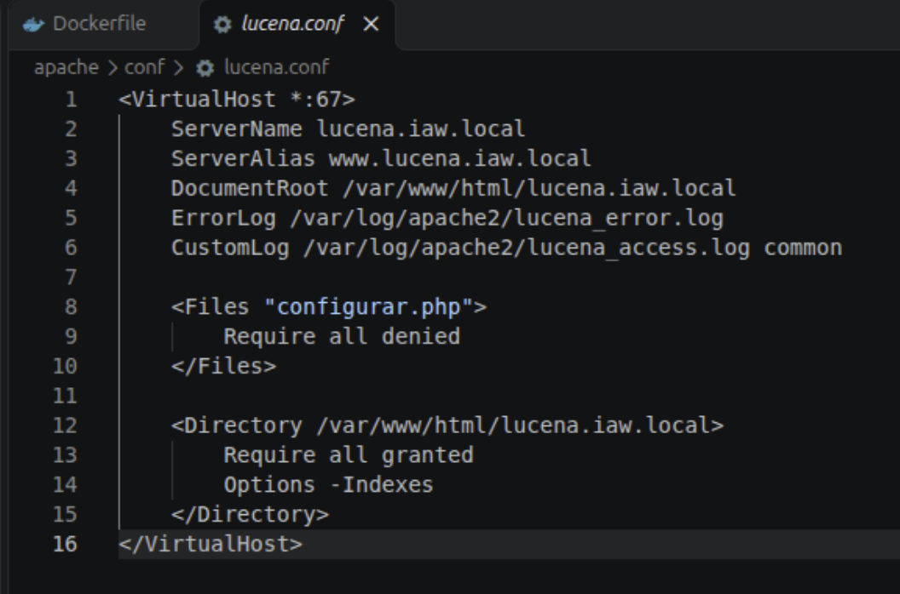

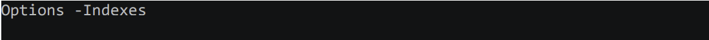
Cuando en Apache intentas entrar en el dominio y este no tiene `index.html`, Apache lista los directorios de la carpeta y entre ellos podría listar el archivo de configuración. Esta opción hace que no salga el archivo de esa forma, o sea, que no se liste.

```apache
<Files "configurar.php">
    Require all denied
</Files>
```

Esto impide que puedas acceder al archivo vía URL, o sea, poniendo en la URL `lucena.iaw.local/configurar.php`.

---

## Crear dominio fantasma

Si por un error de red o por culpa de un atacante, una URL errónea conectara con la IP de mi servidor, en pantalla saldrá la web que se encuentre en el bloque más alto del archivo `vhosts.conf`. O sea, si por un error de internet la URL `nohugo.com` redirigiera a mi servidor, saldría el index de `hugo.iaw.net` por ser la que está más arriba. Para impedir esto y prevenirlo, creo un bloque nuevo en lo alto del archivo para que funcione de muro:

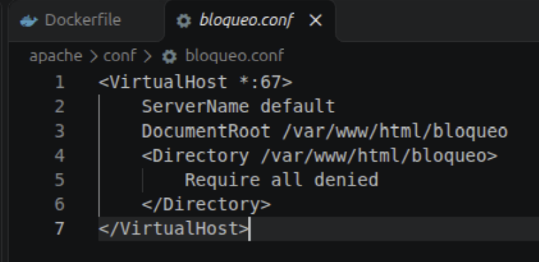

---

## Contenido de cada dominio con curl

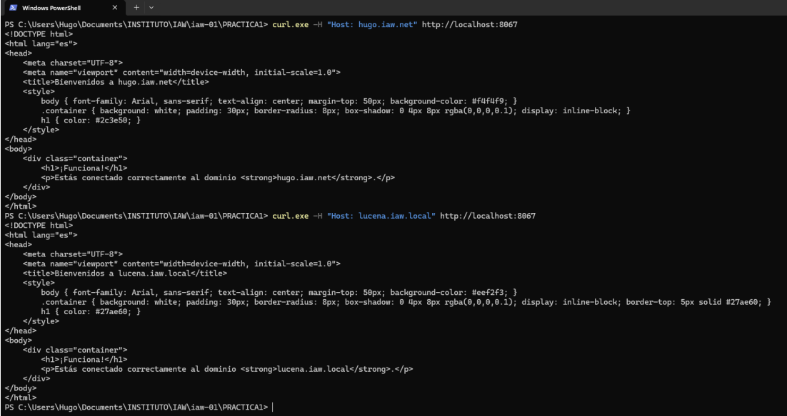

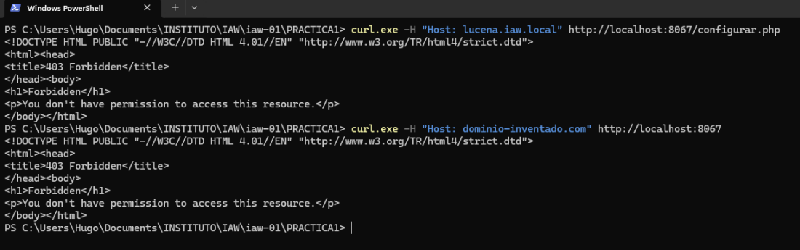

---

# FASE II

## Certificado y clave

Para que la página web tenga certificado HTTPS necesita de una clave privada (la llave que solo tiene el servidor) y de un certificado público (lo que demuestra que la página es, por ejemplo, `hugo.iaw.net`). Voy a crearla usando ECDSA, el estándar moderno que genera claves más seguras.

Me sitúo en la carpeta de la práctica y creo una carpeta nueva (`certificados`) donde crearé un certificado digital cuyo CN va a ser `hugo.iaw.net`.

Primero genero una clave privada usando ECDSA:

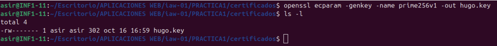

* `openssl` es una herramienta criptográfica para crear claves.
* `ecparam` le indica a openssl que vamos a trabajar con parámetros de curvas.
* `-genkey` ordena que se cree una clave criptográfica nueva.
* `-name prime256v1` especifica el nombre exacto de la curva que se va a utilizar. Es la curva ECDSA estándar exigida por su alta eficiencia y seguridad.

Ahora genero un certificado digital autofirmado usando la clave privada:

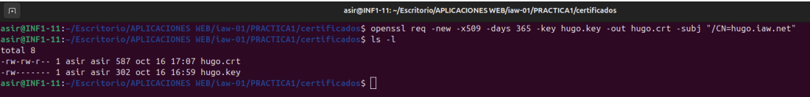

* `req` gestiona las solicitudes de certificados y la creación de certificados autofirmados.
* `-new`: Indica que se va a crear una nueva solicitud de certificado.
* `-x509`: Especifica que en lugar de generar una petición estándar (CSR), queremos emitir directamente un certificado autofirmado.

---

## Protocolos y certificados en Nginx

Primero, creo un archivo de configuración de Nginx llamado `nimbus.conf`:

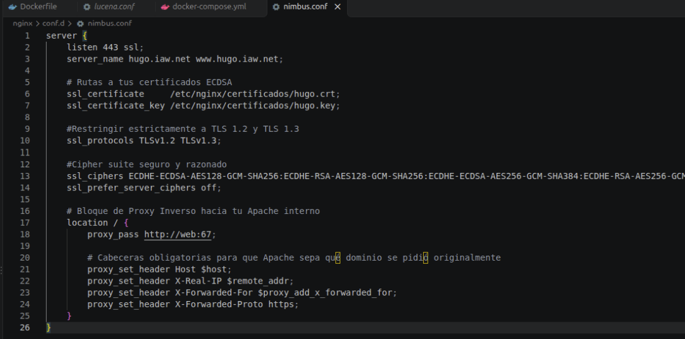

Ahora en `docker-compose.yml` creo un nuevo servicio llamado `proxy` que será para el Nginx:

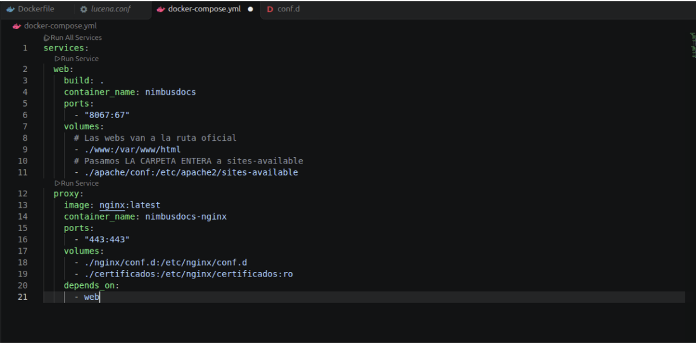

---

## Redirigir a HTTPS

La idea es que cada petición que llegue a través del puerto 80 (HTTP) se redirija automáticamente al puerto 443 (HTTPS).

En el archivo de configuración de Nginx creo un bloque adicional (`server`) que escuche el puerto 80 y devuelva la redirección utilizando la variable `$host` y `$request_uri`:

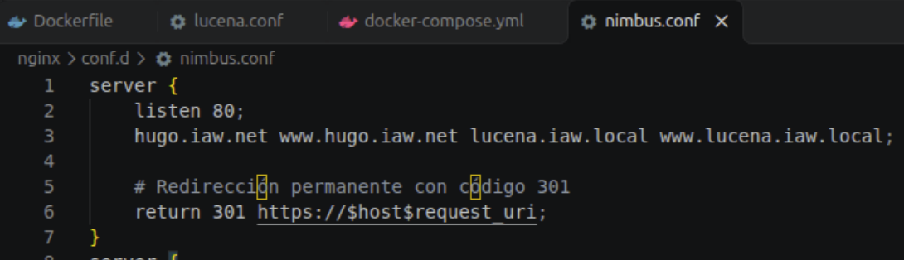

De paso, añado el puerto `80:80` en el `docker-compose` (`proxy`) para que esto funcione.

---

## Importancia de la cabecera Host

Temporalmente, borro las cabeceras del archivo de configuración de Nginx:

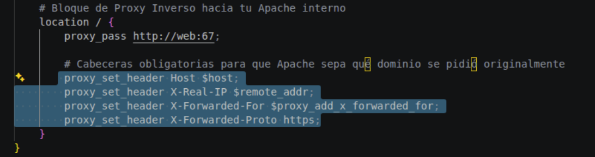

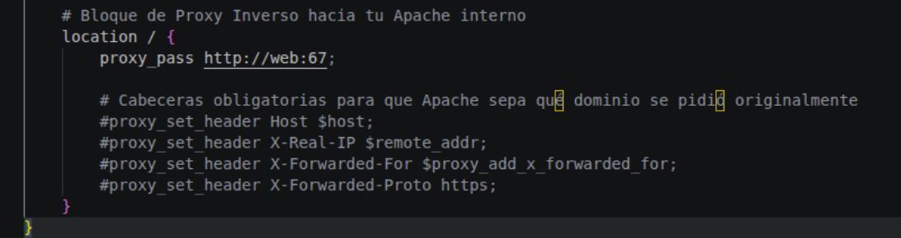

Guardo los cambios y reinicio el docker de Nginx: `proxy` (no hace falta reiniciar todo el docker): `docker compose restart proxy`.

Cuando tú le pides a Nginx `https://localhost:8443/` con la cabecera `Host: hugo.iaw.net`, Nginx actúa como intermediario. Si no le reenvías esa cabecera a Apache, Nginx se la manda al backend llamando simplemente al contenedor `http://web:67` de forma genérica. Apache recibe una petición que no especifica para qué dominio va dirigida. Al no saber qué marca mostrar, Apache recurre por defecto a su VirtualHost bloqueado o genérico (`bloqueo.conf`), el cual tiene denegado el acceso general, devolviendo el `403 Forbidden`.

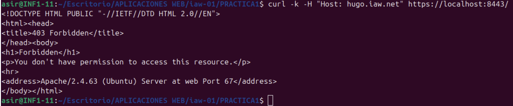

*(Vuelvo a descomentar las cabeceras en nimbus.conf y hago restart)*

---

## Verificar con openssl s_client el protocolo y cifrado negociados

Comprobar mediante la herramienta `openssl s_client` que el protocolo (TLS 1.2 o TLS 1.3) y el cifrado seguro que configuramos en Nginx se están negociando correctamente. Ejecuto:

```bash
openssl s_client -connect localhost:8443 -servername hugo.iaw.net
```

La salida son muchas líneas, tengo que buscar dos líneas en concreto:
`Protocol : TLSv1.3` o `TLSv1.2`

Y otra línea que muestre alguno de los cifrados negociados, como:
`Cipher : ECDHE-ECDSA-AES128-GCM-SHA256`

Salida para el README:

```text
CONNECTED(00000003)
depth=0 CN = hugo.iaw.net
verify error:num=18:self-signed certificate
verify return:1
depth=0 CN = hugo.iaw.net
verify return:1
---
Certificate chain
 0 s:CN = hugo.iaw.net
   i:CN = hugo.iaw.net
   a:PKEY: id-ecPublicKey, 256 (bit); sigalg: ecdsa-with-SHA256
   v:NotBefore: Oct 16 15:07:40 2026 GMT; NotAfter: Oct 16 15:07:40 2027 GMT
---
Server certificate
-----BEGIN CERTIFICATE-----
MIIBhDCCASmgAwIBAgIUSM9J+v96Ej9B8z4+XfyV/GzObicwCgYIKoZIzj0EAwIw
FzEVMBMGA1UEAwwMaHVnby5pYXcubmV0MB4XDTI2MTAxNjE1MDc0MFoXDTI3MTAx
NjE1MDc0MFowFzEVMBMGA1UEAwwMaHVnby5pYXcubmV0MBYwEwYHKoZIzj0CAQYI
KoZIzj0DAQcDQgAEqWA5xU6evGoNWKwb6UVmxKtwIdEFvYlGOywUoauFmUm+YxOZ
F2kM/IaQorJQzFFI/AS+FOmIIZJVhYSKjJZOF6NTMFEwHQYDVR0OBBYEFPcv43+t
PdzOStARCRf1fTdXTaM3MB8GA1UdIwQYMBaAFPcv43+tPdzOStARCRf1fTdXTaM3
MA8GA1UdEwEB/wQFMAMBAf8wCgYIKoZIzj0EAwIDSQAwRgIhANP3eBSSiWT62SOR
mwgC38PYMi+glwaioZa8K01c5DtRAiEAro4bK6z/NvK8RULvIB0vT8YRtxgrH20e
O6v69be6qvk=
-----END CERTIFICATE-----
subject=CN = hugo.iaw.net
issuer=CN = hugo.iaw.net
---
No client certificate CA names sent
Peer signing digest: SHA256
Peer signature type: ECDSA
Server Temp Key: X25519, 253 bits
---
SSL handshake has read 789 bytes and written 394 bytes
Verification error: self-signed certificate
---
New, TLSv1.3, Cipher is TLS_AES_256_GCM_SHA384
Server public key is 256 bit
Secure Renegotiation IS NOT supported
Compression: NONE
Expansion: NONE
No ALPN negotiated
Early data was not sent
Verify return code: 18 (self-signed certificate)
---
---
Post-Handshake New Session Ticket arrived:
SSL-Session:
    Protocol  : TLSv1.3
    Cipher    : TLS_AES_256_GCM_SHA384
    Session-ID: 53D6A6AA0F5915DF9C7875625AB1AD037E43B15E8B211684A90E2F79FBCF523F
    Session-ID-ctx: 
    Resumption PSK: F30981C87FB6AF8AF8477752E700E84C0FB2A25CD76857D8718207625D45D58BA165A540BE9F9257C3844B0E8A0579AE
    PSK identity: None
    PSK identity hint: None
    SRP username: None
    TLS session ticket lifetime hint: 300 (seconds)
    TLS session ticket:
    0000 - 18 f2 58 b0 2c 05 3d 5b-65 b4 2f 2e 44 0a 67 b1   ..X.,.=[e./.D.g.
    0010 - 2f 86 b2 9b 29 61 a5 21-45 a6 26 56 48 06 b3 cb   /...)a.!E.&VH...
    0020 - 9c 92 81 36 fa 7d 76 39-19 92 20 83 66 cf e1 67   ...6.}v9.. .f..g
    0030 - 70 cb 32 8f 83 92 e9 56-15 10 01 55 51 1f 54 59   p.2....V...UQ.TY
    0040 - a8 55 7a c4 c2 a7 74 50-63 d4 65 75 ae e6 a9 18   .Uz...tPc.eu....
    0050 - 67 f6 2e a6 32 ef 36 11-a7 be 9a 15 51 85 10 0a   g...2.6.....Q...
    0060 - eb 3d 6b de c7 2a a2 ba-49 7e d7 dc b6 6a d2 e1   .=k..*..I~...j..
    0070 - c2 3a 36 02 cc b4 0d 5b-ae e7 0c ca dc 03 0c 10   .:6....[........
    0080 - 72 5d c0 f5 0d 09 87 2e-5d da 79 df cd 67 ef f0   r]......].y..g..
    0090 - 77 fd 0c 8e 6e 59 26 53-c3 0f 36 ee 93 7e ad e3   w...nY&S..6..~..
    00a0 - 3a 48 9f c3 d8 91 e4 fb-ec cf 60 1d ed b8 04 8f   :H........`.....
    00b0 - 36 13 7c 52 c6 bc 2b fb-87 5c 04 ce ea de cf 90   6.|R..+..\......
    00c0 - b0 9e 6f 86 d6 6e cb 4a-9a 70 e0 17 3d 75 78 f7   ..o..n.J.p..=ux.
    00d0 - 74 06 7a 1e e7 6a f7 b1-17 71 e3 9d b0 ec 51 96   t.z..j...q....Q.
    00e0 - 03 9f b5 0c 29 e4 8b 38-bc 96 0b 66 ce 52 7e c2   ....)..8...f.R~.

    Start Time: 1792172076
    Timeout   : 7200 (sec)
    Verify return code: 18 (self-signed certificate)
    Extended master secret: no
    Max Early Data: 0
---
read R BLOCK
---
Post-Handshake New Session Ticket arrived:
SSL-Session:
    Protocol  : TLSv1.3
    Cipher    : TLS_AES_256_GCM_SHA384
    Session-ID: 85C287A7FEE494AC39BF9BEC96932BA30E79E7CE5CA58C239BA5069E1AB5A696
    Session-ID-ctx: 
    Resumption PSK: C4A12B0EE52B92C80DE40EB737C17B06A404DF6A4A5FCE985E3B7613CEFC96BA92AB9E49D83B1DD8FDBAA37976BAC934
    PSK identity: None
    PSK identity hint: None
    SRP username: None
    TLS session ticket lifetime hint: 300 (seconds)
    TLS session ticket:
    0000 - 18 f2 58 b0 2c 05 3d 5b-65 b4 2f 2e 44 0a 67 b1   ..X.,.=[e./.D.g.
    0010 - 26 0e e8 3c dc 0f d3 e9-1d 05 e1 91 fd 69 32 34   &..<.........i24
    0020 - 4a 50 4e 05 c3 e3 15 98-18 49 db 68 6f 2c 56 40   JPN......I.ho,V@
    0030 - f5 7b cf 76 9e 49 33 f8-5a 56 e0 7e 63 d4 cc a2   .{.v.I3.ZV.~c...
    0040 - 7c 64 96 9f 4c bb 17 26-9a 51 fd e2 23 d5 6a 2f   |d..L..&.Q..#.j/
    0050 - 1f 37 d0 fc 64 48 10 ab-20 a7 84 2f 4f 70 77 65   .7..dH.. ../Opwe
    0060 - 01 78 38 a0 0e 75 8d 27-74 43 c8 03 c4 24 7f 8c   .x8..u.'tC...$..
    0070 - 69 7b df 02 9e 0a c3 9e-38 f7 da 54 ed 8d 3e 46   i{......8..T..>F
    0080 - 81 cc 95 28 fd a5 a0 95-ca df 73 26 97 8b 3a d8   ...(......s&..:.
    0090 - 0e 2c 0e 16 e7 eb 6e d9-0b 61 db 5a de c8 de e1   .,....n..a.Z....
    00a0 - 19 cf 38 28 ea 78 a0 cf-aa 61 ff e0 84 3d 5a f0   ..8(.x...a...=Z.
    00b0 - 20 52 2c 18 49 28 8c f7-52 aa 84 04 64 35 7b ae   R,.I(..R...d5{.
    00c0 - 4d a1 d2 f2 b7 78 9f 78-d0 9a 8e b2 10 4b 4e 9a   M....x.x.....KN.
    00d0 - 28 5e 31 2a 4f 71 26 a6-6d b4 10 df b4 74 39 86   (^1*Oq&.m....t9.
    00e0 - 16 4d 24 29 31 2c 22 4e-d3 87 e5 a8 90 90 7a 5b   .M$)1,"N......z[

    Start Time: 1792172076
    Timeout   : 7200 (sec)
    Verify return code: 18 (self-signed certificate)
    Extended master secret: no
    Max Early Data: 0
---
read R BLOCK
closed
```

---

## Seguridad y límite de peticiones

Se me pide añadir alguna cabecera de seguridad mínima, como `Strict-Transport-Security` que obliga al navegador a conectarse siempre por HTTPS. También me pide que añada `X-Content-Type-Options` que previene ataques de MIME. Y por último una a mi elección que será `Content-Security-Policy` que restringe qué recursos (scripts, imágenes, hojas de estilo) está permitido cargar el navegador y desde qué fuentes.

Para hacer esto, tengo que modificar el archivo de configuración de Nginx y añadir las líneas que corresponden:

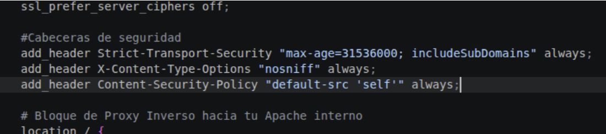

También de paso añado las líneas de `limit`, que sirven para proteger el servidor web frente a ataques de fuerza bruta, bots o scraping. En resumen, controlan el tráfico y diferencian tráfico abusivo del legítimo.

Uno va al principio del archivo de configuración (fuera de los bloques):

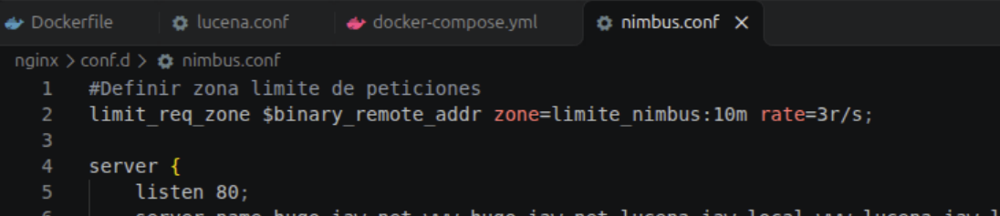

Y el otro va justo al inicio del bloque `location /`:

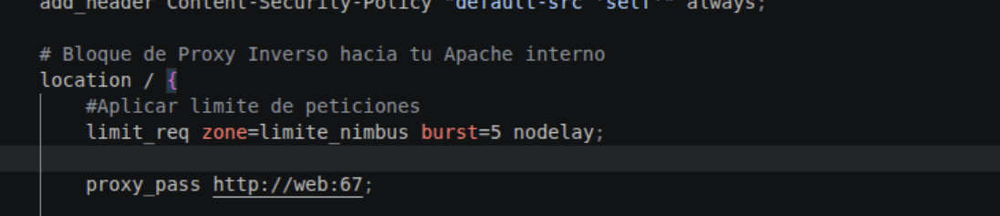

Ahora ejecuto una ráfaga de peticiones repetidas. Si todo está bien, debería de salir algo así:

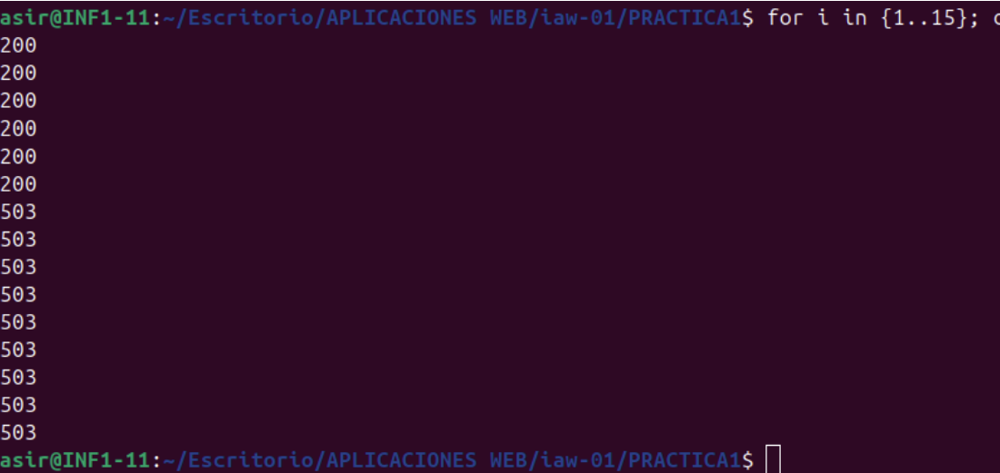

Los primeros números (`200`) corresponden a las tasas de peticiones permitidas.
Y los siguientes (`500`) indican que Nginx ha bloqueado inmediatamente las peticiones sobrantes por haber superado el límite configurado.

---

# FASE III

## Diagnóstico provocado

| Síntoma observado | Hipótesis inicial | Comando de diagnóstico usado | Causa real y solución |
| :--- | :--- | :--- | :--- |
| Al acceder correctamente mediante el proxy con la cabecera Host, Apache devuelve un error 403 Forbidden inesperado, a pesar de que Nginx pasa bien los datos. | Podría ser un problema del puerto al que apunta el proxy inverso o un problema en el directorio de la web | `cat apache/conf/hugo.conf` | El VirtualHost de Apache tiene configurada una directiva de control de acceso restrictiva (`Require all denied`) que bloquea la lectura del directorio.<br><br>**Solución:** Modificar la directiva en el VirtualHost a `Require all granted`. |
| Al realizar una petición HTTPS contra el proxy inverso, Apache responde directamente con un 403 Forbidden genérico y el puerto del backend. | El servidor web interno (Apache) está apagado o el contenedor no responde en el puerto 67. | `curl -k -H "Host: hugo.iaw.net" https://localhost:8443/`<br>combinado con la revisión del bloque location en Nginx. | Nginx no estaba reenviando la cabecera Host del cliente (`proxy_set_header Host $host;`), por lo que Apache no podía identificar a qué VirtualHost dirigido correspondía la petición y aplicaba el bloqueo por defecto.<br><br>**Solución:** Descomentar la directiva `proxy_set_header Host $host;` dentro del bloque `location /` de Nginx y reiniciar el proxy. |

Pruebas de los errores ejecutados:

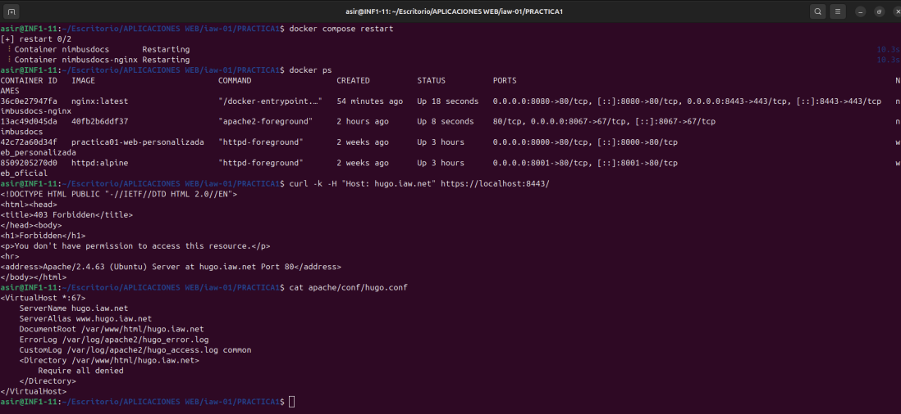

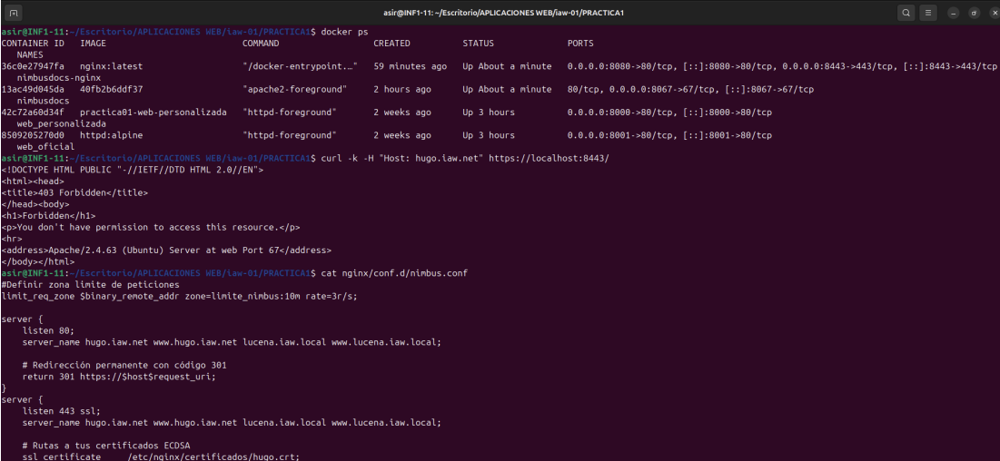

# DOCUMENTACION QUE SE PIDE PARA EL README
## Fase I. Punto 3
Un dominio que no coincida con ningún Virtual Host debe caer en un comportamiento controlado por vosotros (no el primero al azar) — explicad en el README por qué pasa eso.
* Apache procesa e incluye los archivos .conf cargados por orden alfabético estricto. Al nombrar el archivo de bloqueo como bloqueo.conf, este se evalúa en primer lugar (antes que hugo.conf y lucena.conf). Como en Apache el primer VirtualHost cargado actúa siempre como el VirtualHost por defecto, cualquier petición con un nombre de dominio que no coincida con los ServerName de las marcas cae automáticamente en bloqueo.conf (el cual contiene la directiva Require all denied).

## Fase II. Punto 2
Configurar el bloque server de Nginx con ssl_protocols restringido a TLS 1.2 y 1.3 (nada de versiones obsoletas) y un cipher suite razonado en el README.
* Se usan suites ECDHE y AES-GCM para garantizar Forward Secrecy (PFS), seguridad robusta y rendimiento con aceleración por hardware.

## Fase II. Punto 3
Redirigir automáticamente todo el tráfico HTTP (puerto 80) a HTTPS con un código de estado correcto — justificad en el README por qué ese código y no otro.
* return 301 https://$host$request_uri indica al cliente que el cambio a HTTPS es definitivo para que la cachee y fuerze el puerto seguro.

## Fase II. Punto 5
Verificar con openssl s_client el protocolo y cifrado negociados, y adjuntar la salida real (no una captura de pantalla del guion) en el README.
* Esta en uno de los apartados de este documento mucho mas arriba

## Fase II. Escenario de carga
El equipo de NimbusDocs ha medido que un usuario legítimo leyendo documentación genera como máximo 3 peticiones por segundo de forma sostenida, con picos breves de hasta 6 peticiones/segundo al recargar varias pestañas a la vez. El mes pasado detectaron un script de scraping haciendo más de 20 peticiones por segundo contra la misma ruta. Calculad y justificad en el README los valores de rate y burst de vuestro limit_req_zone que bloqueen ese patrón de scraping sin penalizar a un usuario legítimo en pico.
* Permite el tráfico legítimo y picos de pestañas múltiples, pero satura el búfer y bloquea con 503 los scripts de scraping masivo